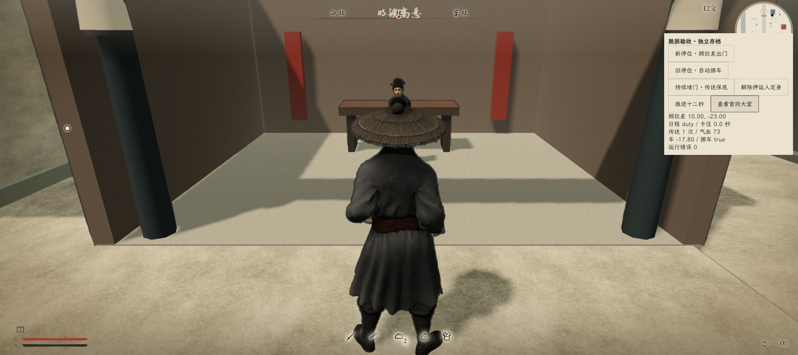
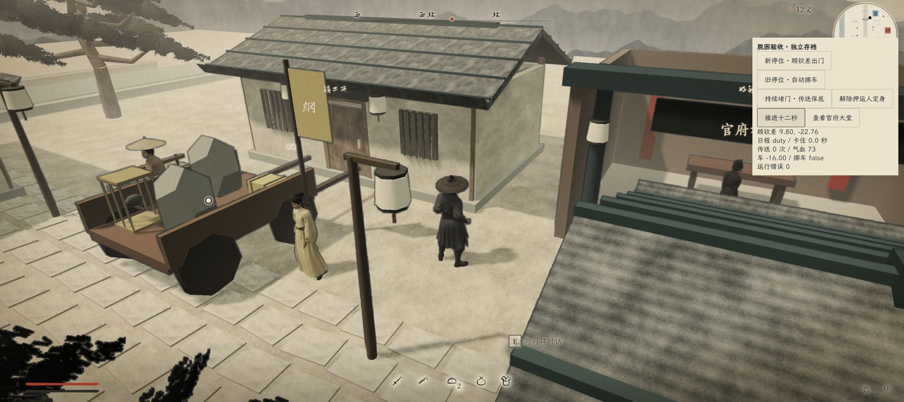

# NPC 脱困与公所通道验收

2026-11-11，本地源码修复；未发布。

## 原因与处理

- 原货车停位 `(0, -17.8)` 的碰撞覆盖镇公所门外落脚点 `(0, -19.6)`。新停位改为 `(0, -16)`，给出门和横向绕行留出通道。
- 旧 v2 档中已经抵达原停位的货车，由原押运人就位后缓缓倒挪至新位置。危险、倒地、定身、睡眠和车体损毁仍阻止挪车；中途存档可续接，不再次触发到达奖励，不改货物和损伤。
- 通用脱困仍只累计真实移动尝试：约 3 秒清路重算，约 9 秒无进展才尝试传送。转身、换路中的短空帧不清空累计；连续停步半秒或被暂停则清空。
- 传送在原当值点附近最多 6 米内寻找空位，检查身体余量和至少一小段可走通道；排除封闭居室、深水、火场、玩家和其他人物占位，且不原地传送。找不到安全点则继续等待。
- 战斗、追捕、调查、逃跑、拘押、睡眠、定身、环境危险、对白和演出不触发脱困。传送只改变位置和导航记录，保留气血、体力、钱、毒性、物品、关系、记忆、证据和剧情。传送后停留 6 秒，冷却 30 秒，并清理视觉移动速度。

## 自动测试

以下 84 项测试通过：

```powershell
node --test --test-reporter=dot tests/npc-recovery.test.js tests/convoy-scene.test.js tests/convoy.test.js tests/fixed-posts.test.js tests/night-life.test.js tests/night-scene.test.js tests/npc-life.test.js tests/npc-motion.test.js tests/npc-awareness.test.js tests/npc-territory.test.js
```

覆盖短暂转身、持续阻塞、小幅震荡、封闭落点、无安全落点、多人占位、状态保留、冷却、正常移动与静止排除、危险与拘押排除、货车通道、旧停位挪车和中途读档。`npm run check`、新增模块语法检查和差异空白检查通过。

## 浏览器试玩

使用 `http://localhost:8091/?playtest=recovery-qa`，独立存档；不读取或重置玩家档。

- 新停位：顾钦差从镇公所走出，正常前往官府大堂，传送次数为 0。
- 持续堵门：让押运人保持定身，原车仍挡门；顾钦差持续尝试后传送 1 次，到 `(10, -23)` 恢复当值，气血仍为 73。继续运行未反复传送。
- 旧停位自动调整：车缓缓从 `-17.8` 挪至 `-16`，顾钦差正常走至约 `(9.80, -22.76)` 恢复当值，传送次数为 0。
- 上述试玩运行错误记录为 0；未更改生产 HUD 或配音。





边界：落点检查提供局部可行走空间，并非对整个城镇证明全局可达；完全无安全点时不强行传送。旧档挪车仍需押运人恢复行动。
