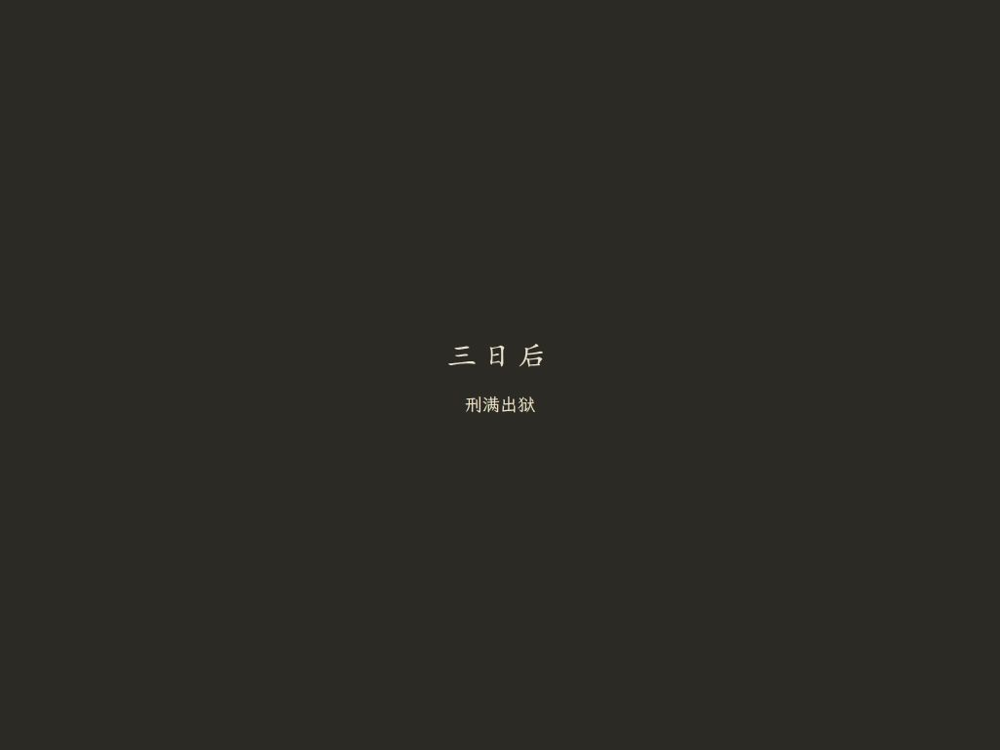
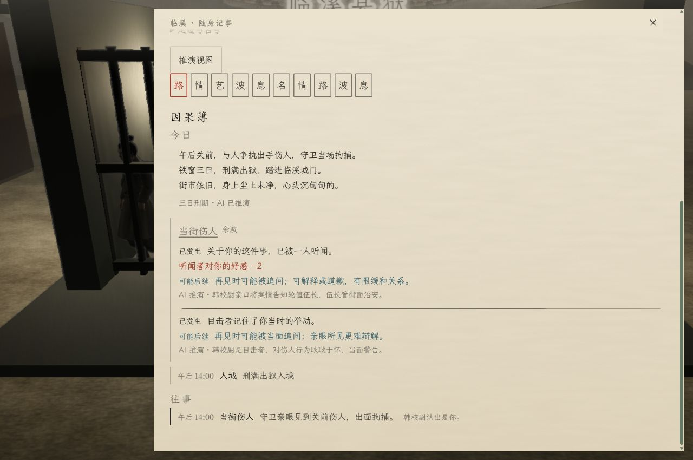
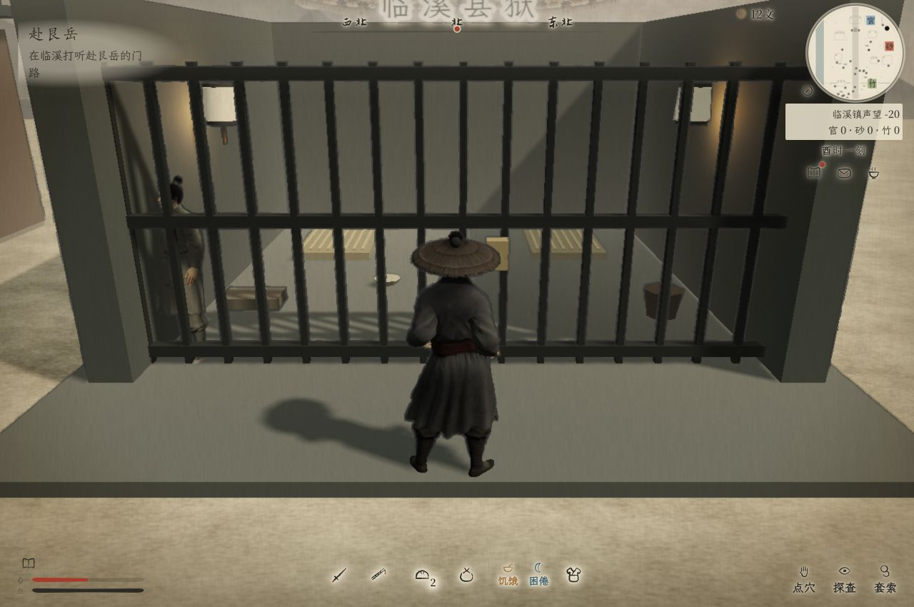

# 刑满出狱：时间流逝与 AI 余波

## 改动

- 原先刑满出狱直接 `day += 3`，绕开每日更新与余波推演。现在逐日处理三天到期后续，在出狱事实记录完成后请求 `/api/director` 的 `aftermath` 模式。
- 三日刑期合并为一次事实批次；与夜间、自然换日共用串行处理，避免同一前因重复结算。模型只选择本地合法候选、补写日记与措辞，关系等后果仍由本地规则落地。请求期间候选失效不会造成索引错配。
- 选择“服满三日”或“记下口供后出狱”后，约 1.87 秒淡黑、停留、淡回，字幕为“三日后 / 刑满出狱”。完全黑幕后才推进刑期并移动到出狱点；Esc 可以缩短表现，不能重复结算。
- 普通因果簿显示日记与真实余波；推演视图另显示 AI 成功、模型未连接、超时或输出未通过校验等状态。模型失败采用本地兜底，不延长黑幕等待。
- 未完成的出狱表现可以读档恢复；已出狱但未推演的存档补接推演，不重服刑、不重复扣风仪或发口供。
- 新界面仅两行字幕；省去原通用动作等待与结果卡。调试来源只在“推演视图”显示。

## 实测与证据

- `npm run check` 与新模块语法检查通过。`npm test`：1020 项通过，0 失败，输出保留在 `.artifacts/prison-all-tests.txt`。
- `tests/prison-release.test.js` 覆盖三天到期后续、黑幕中点结算、重复点击、跳过、中途读档、口供一次发放、旧出狱存档补推演、并发去重、候选变动与模型兜底。
- 在 `http://127.0.0.1:8091/?playtest=prison-release-qa` 使用独立试玩存档，未覆盖正式存档。真实请求返回 HTTP 200，日记 `ai: true`，两条余波被接受为 AI 选择。接口请求与界面报告见 [live-report.json](prison-release/live-report.json)，没有替换模型响应。
- 三档窗口 1280×850、1024×768、800×600 实测黑幕字幕居中，无截断、无 HUD 叠字。题字 30px、正文 18px，分别使用项目行书与文楷字体；推演状态文楷 14px。浏览器错误记录为空。
- 黑幕后已恢复探索、角色位于牢外；保存了探索清屏画面。推演视图实测显示“三日刑期 · AI 已推演”。

## 边界

这是三日到期事实的一次 AI 余波推演，未增加逐夜三次独立模型调用，也未制作完整的三日牢内生活演出。模型离线、超时与无效输出由自动测试验证；本次浏览器实测为在线成功路径。
