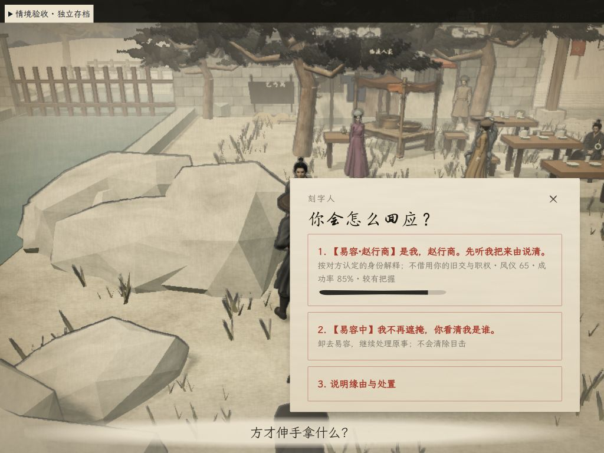
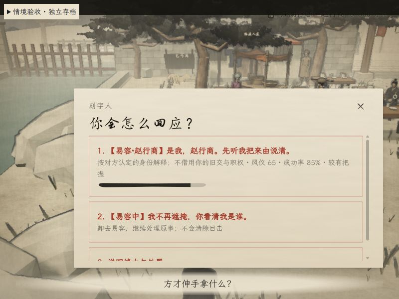

# 特殊状态回应接入记录

日期：2026-11-11。本轮实现本地条件匹配，不调用实时对白生成服务。候选设计全集见 [设计稿](../../plans/2026-11-11-contextual-responses-design.md)。

## 实际接入

19 条共用候选规则接入新章当面问责及负面余波。规则按具体场合筛选，并非每个场合都有全部选项：

| 类别 | 标签与条件 |
| --- | --- |
| 身体处境 | 【气血低】【身体不适】【体力不支】【盘缠不足】【饥饿】；饥饿只关联偷食物，未发作毒性不当作已知病症 |
| 衣着与面貌 | 【易容·已知姓名】【差役服】或【官兵装束】【易容中】；穿戴、姓名知识、真实入职分别检查 |
| 势力 | 六扇门、赤砂帮的正常亮明身份，以及另一个有后果的借势施压选项；六扇门要求实际携带腰牌；限权后明确标注【六扇门·限权】 |
| 人际经历 | 【共同熟人·姓名】【杜老捕引荐】【受过指点】【曾照看你】【素有信任】；只用已有关系证据，授艺和照看保留当时认定的身份 |
| 本次实物 | 【原物在手】【原物已还】【物品未取走】；匹配本次事件的物品编号，归还走共用转移逻辑 |
| 既往问责 | 【屡次失信】；同人、同身份的不同前因 |

身份盘问另有四种本地说法：低气血、已发作病症、当前衣着、当前易容面貌。原主或已识破者仍按确定事实处理，不能靠身体借口绕成概率检定。

- 特殊选项均用【触发原因】。标签不进入玩家实际说出口的台词。
- 直接物证、具体身份和相关经历优先；身体借口只保留优先级最高的一条。低气血与曾照看对方可以组合显示。
- 每层至多三项；导航不掷骰、不扣资源、不插入填充对白，有返回图标和 Esc 返回。
- 预览和执行重查同一事实与概率。实际掷骰时接共用检定表现，再接玩家与 NPC 的本地对白。
- 暂缓只给十秒喘息，问责保留。伤人赔偿不清除责任。再次打开、读档和重复提交不重复收款或归还。
- 亲见和传闻沿用不同难度。余波每人每个前因只结算一次，有限修复关系不清除证据或嫌疑。
- 问责和目击通知共用一个前因；每个目击者的身份认定冻结，卸妆后跨夜余波不改记真身。

## 借势后果

明确选择借势施压才产生报告，正常亮明身份不算违规。成功与失败都能留下原话和受话人记录。

报信人按世界中的位置寻路到负责人，近距离且无遮挡才递报。安全回程让位于报信；危险、避火、死亡、定身、睡眠、失声等会阻止或中断，恢复后继续。负责人移动时目标跟随其实际位置。

负责人通过原有交谈入口提出核问，有【有人递报】和【门内核问】标签。一份单方口述不直接处分；当事人承认，或确有原先在场且实际到场的佐证后，才按独立事件累计告诫、限权、除名。势力声望分开记账，同一前因不重复罚。除名后留下的实体腰牌不再赋予权限，不能重新入职刷奖励；已学能力保留。

## 验证证据

- 最终当前工作区全套：`node --test tests/*.test.js`，601/601 通过。早先三项失败已在共享工作区更新后消失；本轮未靠删掉断言通过检查。
- `npm run check` 通过；另对本轮十三个相关脚本执行语法检查通过。
- 专项覆盖：状态过期、物品离手、距离与墙体、已识破身份、未完成教学、乔装授艺、一次暂停、一次赔偿、归还穿戴物、分页与返回、跨夜归因、同前因去重、独立处分递进、除名权限、递报移动及危险中断。
- 独立浏览器试玩键：`playtest=context-qa`。未操作玩家正式存档；本地夹具只在 localhost 启用。
- 实际点击验证了低气血优先、真实检定、玩家台词、NPC 允许喘息但继续问责；借势选项成功后关系 -4 并留下 pending 报告；易容优先标签、分页与返回。
- 1280×850 检查过低气血选项；1024×768、800×600 留有易容选项截图。小窗口正文可滚动，关闭和返回入口可见；所检查选项为 16px 正文、14px 说明，使用项目文楷字体栈。
- 界面增量只增加有意义的原因标签和必要的结果说明；返回使用既有图标，无新增常驻操作说明或填充对白。

## 仍待补验与扩展

浏览器随后无法接收输入或创建页面。已保存两张截图，窗口尺寸覆盖已恢复默认。**修正后的完整“报信 → 核问”实景点击、最终探索清屏截图，以及全部 HUD 同屏压力组合尚未完成浏览器复验**；移动/核实规则已有自动化测试，不将它们表述为完整场景演出验收通过。夹具残留警觉导致的报错已修复，跨线程同时修改造成的重复 import 已消除并通过最终检查。

设计中的 64 个基础候选和 12 个组合是扩展目录，本轮未全部上线。实际到场担保、赊欠分期、劳动抵偿、修补等尚无完整动作链，不显示只有承诺却无法兑现的选项。本轮没有生成新录音或改人物声音；字幕走现有配音与失败回退流程。

